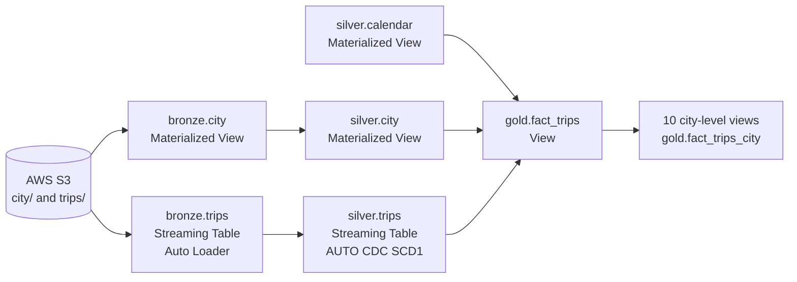
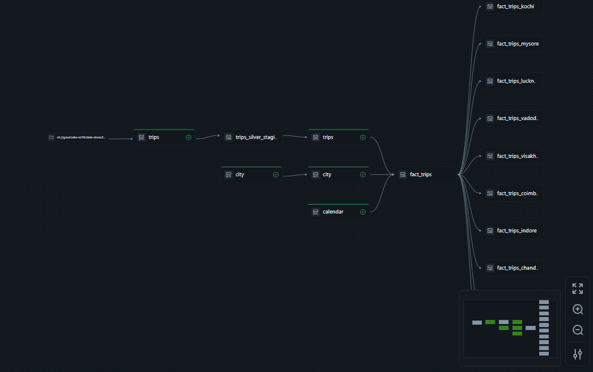

# Lakeflow SDP Transportation Lakehouse
 
An end-to-end data engineering project that builds a cab-trip lakehouse with **Databricks Lakeflow Spark Declarative Pipelines (SDP)**, following the **Medallion architecture** (Bronze → Silver → Gold) on **Unity Catalog**, with source data stored in **AWS S3**.
 
## Overview
 
**Business scenario:** GoodCabs is a fictional ride-hailing company operating across Indian cities. Regional managers need fast, city-specific analytics to make better decisions, but the raw data is not ready for analysis.
 
**Solution:** a declarative pipeline that ingests raw city and trip files from S3, processes new data incrementally, validates and standardizes it, and publishes BI-ready fact views, including one view per city so each regional manager can work with only their city's data.
 
### Highlights
 
- Declarative pipeline with 17 datasets (streaming tables, materialized views and views)
- Incremental file ingestion with **Auto Loader**
- Upserts with **AUTO CDC (SCD Type 1)**
- Data quality **expectations** on dates and ratings
- Generated **calendar dimension** with weekday/weekend flags and national holidays
- Star-schema style gold fact view, plus 10 city-level views
## Architecture
 

 
### Pipeline DAG
 
The DAG below is the actual pipeline as it runs in Databricks: S3 source → bronze → silver → `fact_trips` → city-level views.
 

 
| Layer | Purpose | Objects |
|---|---|---|
| Bronze | Raw data as ingested, plus metadata | `bronze.city`, `bronze.trips` |
| Silver | Cleaned, validated, standardized data | `silver.city`, `silver.trips`, `silver.calendar` |
| Gold | Analytics-ready data for BI | `gold.fact_trips` and 10 city-level views |
 
## Tech Stack
 
- Databricks (Free Edition) with Lakeflow Spark Declarative Pipelines
- PySpark and SQL
- Delta Lake
- Unity Catalog (catalog `transportation`; schemas `bronze`, `silver`, `gold`)
- AWS S3, connected through a Unity Catalog External Location
## Dataset
 
The dataset is based on the GoodCabs case study and has two parts, stored in S3:
 
| Folder | Content |
|---|---|
| `city/` | `city.csv` with `city_id`, `city_name` |
| `trips/` | Trip files: one full load and one incremental load |
 
Trip columns: `trip_id`, `date`, `city_id`, `passenger_type`, `distance_travelled(km)`, `fare_amount`, `passenger_rating`, `driver_rating`.
 
The data files are not included in this repository.
 
## Pipeline Details
 
### Bronze (raw ingestion, Python)
 
- `bronze.city`: batch read of `city.csv` as a materialized view.
- `bronze.trips`: streaming table using **Auto Loader** (`cloudFiles`) with column type inference and `rescue` schema evolution, so newly arriving files are picked up automatically.
- Adds metadata columns `file_name` and `ingest_datetime`.
- Renames `distance_travelled(km)` to `distance_travelled_km`.
### Silver (cleaned and validated, Python)
 
- `silver.city`: standardized city dimension.
- `silver.calendar`: date dimension (year, quarter, month, week, day of week, weekday/weekend flags, national holidays) generated from the pipeline parameters `start_date` and `end_date`.
- `silver.trips`: a staging view applies column standardization and data quality expectations, then **AUTO CDC (SCD Type 1)** keyed on trip `id` upserts the data into a streaming table, so reprocessed or updated trips replace the old record instead of creating duplicates.
Data quality expectations:
 
| Expectation | Rule |
|---|---|
| `valid_date` | Trip year >= 2020 |
| `valid_driver_rating` | Driver rating between 1 and 10 |
| `valid_passenger_rating` | Passenger rating between 1 and 10 |
 
### Gold (analytics-ready, SQL)
 
- `gold.fact_trips`: trips joined with the city and calendar dimensions.
- `gold.fact_trips_<city>`: one view per city (Chandigarh, Coimbatore, Indore, Jaipur, Kochi, Lucknow, Mysore, Surat, Vadodara, Visakhapatnam), each filtered by `city_id`. These make it simple to give a regional manager access to only their city's data.
## Project Structure
 
```
lakeflow-sdp-transportation-lakehouse/
├── README.md
├── images/
│   └── pipeline_dag.png
└── transformations/
    ├── project_setup.ipynb      # creates the catalog and schemas
    ├── bronze/
    │   ├── city.py
    │   └── trips.py
    ├── silver/
    │   ├── calendar.py
    │   ├── city.py
    │   └── trips.py
    └── gold/
        ├── trips_gold.sql
        └── trips_<city>.sql     # 10 city-level views
```
 
## How to Run
 
1. Create an S3 bucket with the folders `data-store/city/` and `data-store/trips/`, and upload the CSV files.
2. In Databricks, create a Unity Catalog **External Location** that points to the bucket.
3. Run `transformations/project_setup.ipynb`. It reads a `catalog_name` widget (default `transportation`) and creates the catalog with the `bronze`, `silver` and `gold` schemas.
4. Update `SOURCE_PATH` in `bronze/city.py` and `bronze/trips.py` to your own bucket path.
5. Create a new **Lakeflow Declarative Pipeline**, set its source code to the `transformations/` folder, and choose `transportation` as the target catalog.
6. Add the pipeline parameters `start_date` and `end_date` (format `YYYY-MM-DD`) to cover the date range of your trips data.
7. Run the pipeline for the first full load. To test incremental processing, upload the incremental trips file to S3 and run the pipeline again.
## Example Queries
 
Total sales and trips per city and month:
 
```sql
SELECT city_name,
       month_year,
       COUNT(*)        AS total_trips,
       SUM(sales_amt)  AS total_sales
FROM transportation.gold.fact_trips
GROUP BY city_name, month_year
ORDER BY city_name, month_year;
```
 
Weekday vs weekend average rating for one city:
 
```sql
SELECT is_weekend,
       ROUND(AVG(passenger_rating), 2) AS avg_passenger_rating,
       ROUND(AVG(driver_rating), 2)    AS avg_driver_rating
FROM transportation.gold.fact_trips_chandigarh
GROUP BY is_weekend;
```
 
## Key Learnings
 
- Declarative vs imperative pipeline development
- Medallion architecture design with Unity Catalog
- Incremental ingestion with Auto Loader and streaming tables
- Handling updates with AUTO CDC (SCD Type 1)
- Data quality expectations in declarative pipelines
- Building a calendar dimension and a star-schema style fact view
- Connecting Databricks to AWS S3 securely with External Locations
## Author
 
**Shah Zaman Jalil**
GitHub: [Shahzaman-Jalil](https://github.com/Shahzaman-Jalil)
